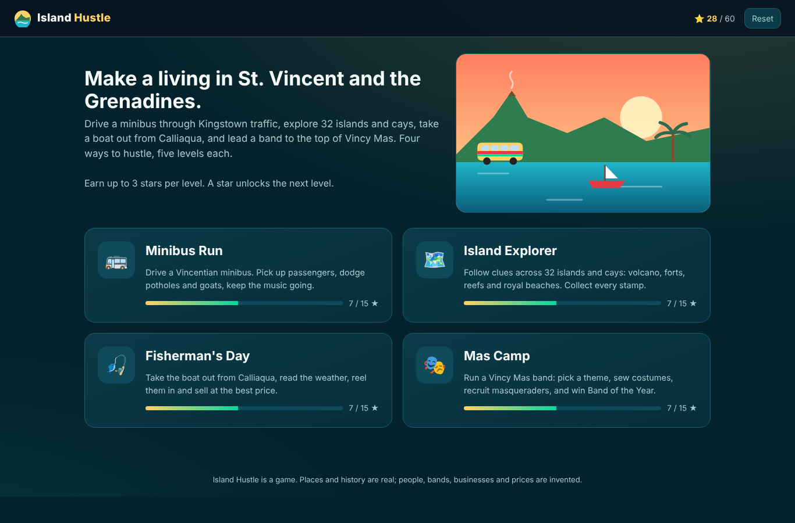
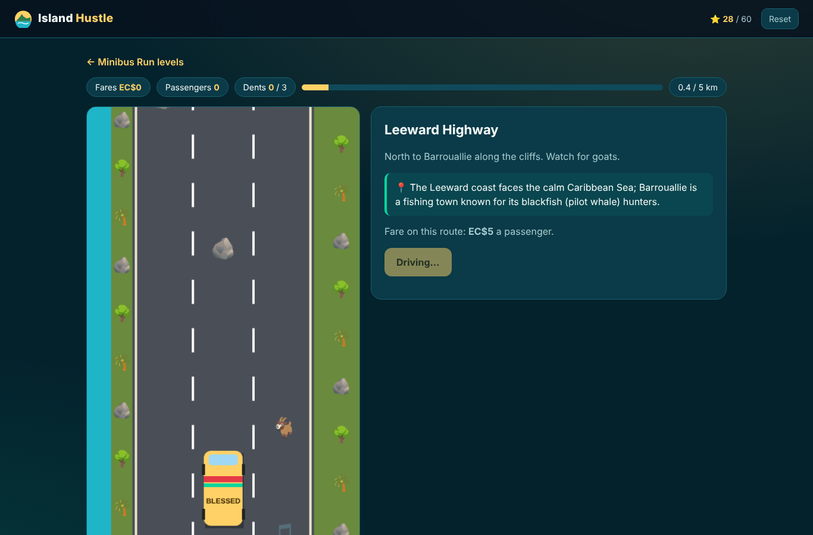
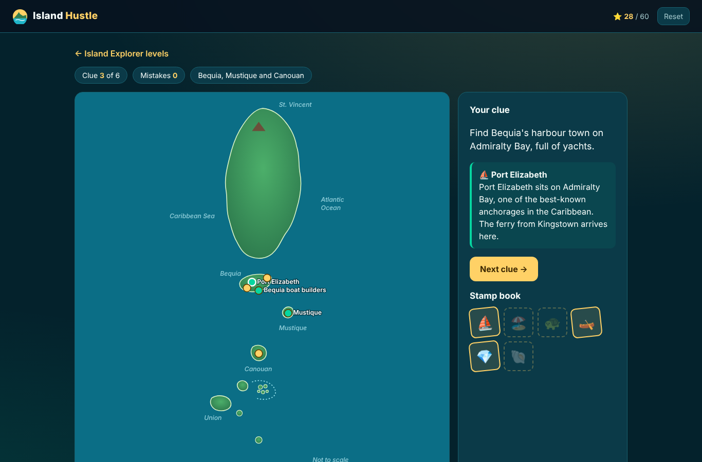
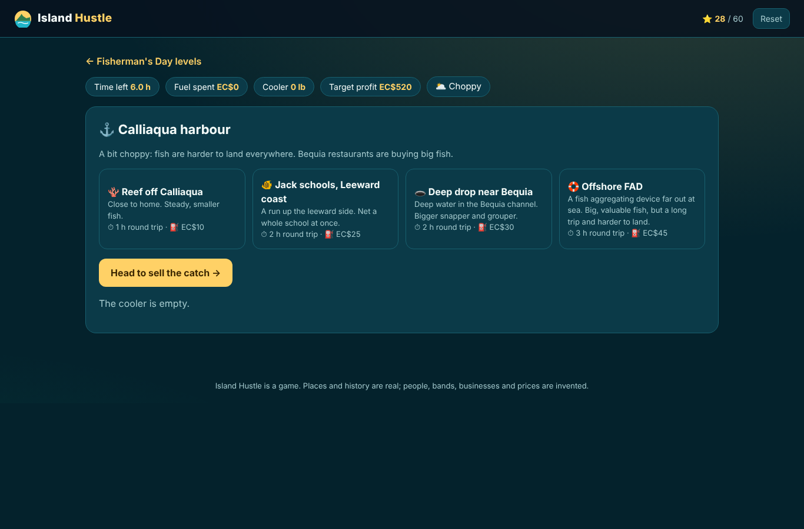
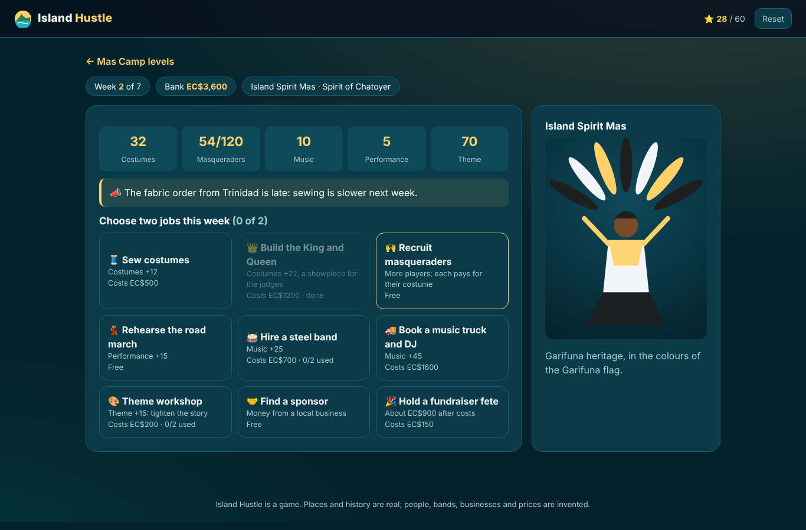

# Island Hustle

**A game about making a living in St. Vincent and the Grenadines, in four modes and 20 levels.** Drive a minibus through traffic, explore the islands with clues and stamps, take a fishing boat out from Calliaqua, and lead a carnival band to Band of the Year at Vincy Mas.

**[Play it](https://jody2905.github.io/island-hustle/)**. It runs in any browser, on desktop or phone, with nothing to install.



## The four modes

### 🚌 Minibus Run
Drive “Blessed”, a 15-seater with loud speakers, along five real routes: Kingstown to Arnos Vale, up to Mesopotamia, the Leeward Highway to Barrouallie, the rainy windward coast to Georgetown, and carnival night. Change lanes to pick up passengers at the stops, grab soca notes for double fares, and dodge potholes, goats, chickens, trucks and road works. Three dents and the bus is off the road.



### 🗺️ Island Explorer
An illustrated map with 30 places across five regions, from Fort Charlotte and the Botanic Gardens to La Soufrière, Black Point Tunnel, Wallilabou Bay, Bequia's turtle sanctuary, the Tobago Cays and Petit St. Vincent. Read each clue, find the place, and earn its stamp and a short piece of real history.



### 🎣 Fisherman's Day
Six hours of daylight, a boat and a cooler. Choose between the reef, the jack schools on the Leeward coast, a deep drop near Bequia and an offshore FAD, each with its own travel time, fuel cost and fish. Reel in with a timing game, then sell at the Kingstown market, to Bequia restaurants or at the roadside. Later days bring choppy seas, a small cooler and a midday squall.



### 🎭 Mas Camp
Run a band for Vincy Mas. Pick a theme (Soufrière Fire, Hairouna Sea, Botanic Bloom, Spirit of Chatoyer or Vincy Gems) and three costume colours that suit it. Then spend each week on two jobs: sewing, building the King and Queen, recruiting masqueraders, rehearsing, hiring a steel band or a music truck, finding sponsors, or holding a fete. Rain, late fabric and rival bands get in the way. On judging day you're scored on costumes, size, music, performance and theme against three rival bands.



## Scoring

Every level awards up to three stars, and one star unlocks the next level. Progress is saved in your browser. Stars come from fares collected, stamps found without mistakes, profit over the day's target, and your band's place on judging day.

## How it was made

Plain HTML, CSS and JavaScript, with no frameworks or libraries. Minibus Run draws on an HTML canvas, and the map and costumes are SVG. It shares its engine (levels, stars, saved progress, results) with [Cyber Shift](https://github.com/Jody2905/cyber-shift). Each mode was play-tested by automated bots to check that every level can be won and that the difficulty rises.

```
index.html          the page
css/style.css       shared game styles      css/island.css   this game's look
js/core.js          hub, levels, stars, saved progress, results
js/minibus.js       Minibus Run (canvas)
js/explorer.js      Island Explorer (SVG map, 30 places)
js/fishing.js       Fisherman's Day
js/mascamp.js       Mas Camp
```

To run it locally, open `index.html` in a browser.

## Note

The places and history are real, and the map is drawn by hand, not to scale. The people, bands, businesses, fares and fish prices are invented for the game.

## License

MIT
